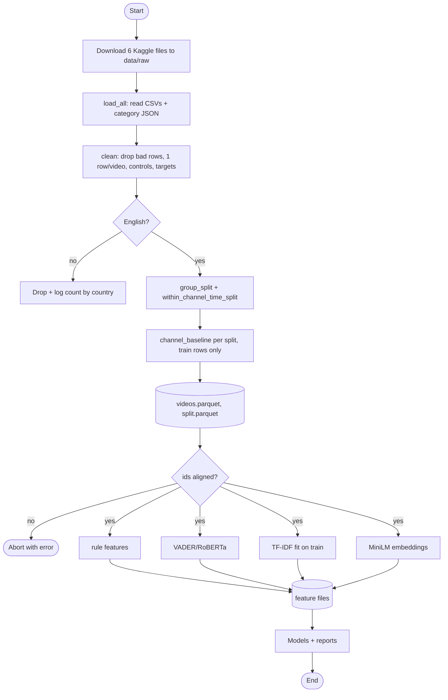
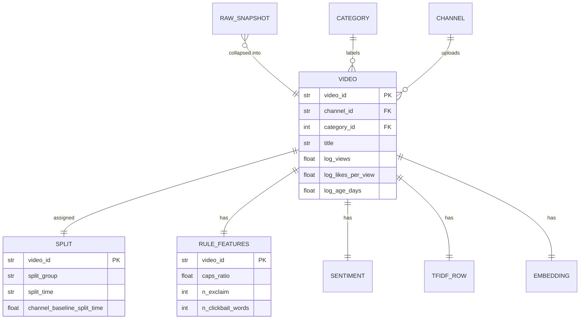
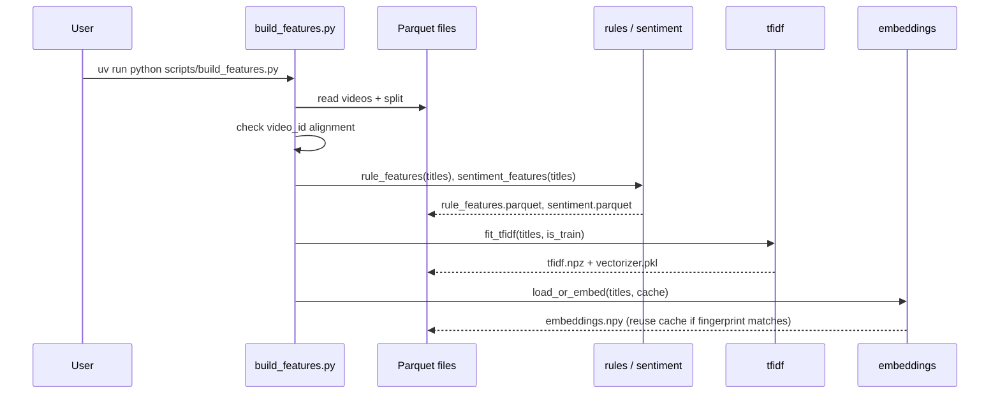

# Does Clickbait Work? Title Features and Engagement on YouTube Trending Videos

**Project Specification** · DSC 200, Fall 2026 · Project Update (due Mon 11/23) · Repo: `yt-clickbait`

**Team:** In A Park, Rudy Ramachandran, Guillermo Montoya, Kevin Kakkary (contact)

---

## 1. Introduction

### 1.1 Background & Goal

YouTube titles are the first thing a viewer sees. Creators use "clickbait" tactics
(ALL CAPS, `!!!`, numbers, emojis, "you won't believe…") to win clicks, but it is unclear
which tactics actually go with more views, and whether they cost goodwill afterwards
(fewer likes or comments per view).

**Goal:** measure which clickbait title features are associated with (a) views and
(b) engagement on trending YouTube videos in the US, GB, and CA, after controlling for video
age, timing, category, and the creator, and check whether the answer differs by category.

**How (high level):** clean the public Kaggle trending dataset to one row per video, turn each
title into features (14 hand-crafted clickbait features, VADER + RoBERTa sentiment, TF-IDF,
MiniLM sentence embeddings), then fit interpretable regression models on two train/test
splits — one that holds out whole channels and one that holds the channel fixed — to separate
the title's effect from the creator's.

**Intended users:** creators and marketers choosing titles; analysts studying engagement.

**Definition of done (from the proposal)** and where each item is specified:

| # | Done when… | Requirements |
|---|-----------|--------------|
| D1 | US/GB/CA files load and clean into one deduplicated dataset, one row per video, category names mapped | FR-1, FR-4, FR-8 |
| D2 | Rule-based clickbait features plus sentiment, TF-IDF and embeddings exist for every title | FR-2, FR-5, FR-10 |
| D3 | Models predicting log(views) from (a) rules, (b) TF-IDF, (c) embeddings, controlling for age, are compared on held-out data | FR-3, FR-6, FR-11 |
| D4 | Interpretable models identify which words/features go with higher views and lower likes or comments per view, overall and by category | FR-7, FR-12 |
| D5 | Final report with visualizations ranking the most effective and most overused tactics | FR-9 |

### 1.2 Changes since the proposal

**Q: Is popularity due to the title, or to the creator, social trends, etc.?** We treat
everything that is not the title as a confounder and control for it:

| Confounder | How we handle it |
|------------|------------------|
| Creator (audience size, reputation) | Channel-grouped split, within-channel time split, out-of-fold channel baseline, channel fixed effects (below) |
| Macro trends / news cycles / platform changes | `publish_week` fixed effects |
| Time on platform | `log_age_days` (days from publish to snapshot) |
| Topic | Category, and per-category models |
| Release timing | Publish hour and weekday (UTC) |
| Promotion effort / metadata | Tag count, description length |
| Reach | Number of countries the video trended in |
| Not in the data | Subscriber count, thumbnail, video length, outside promotion — stated as limitations; the channel baseline partly stands in for subscribers |

**Q: How does a single-creator model differ from one that samples across creators?** In a
pooled model a feature can look effective just because big channels happen to use it. We
therefore fit both versions and compare:

- *Across creators* — `split_group`: every channel is entirely train or entirely test.
  Answers "does the title help predict views for a creator the model has never seen?"
- *Within creators* — `split_time`: channels with ≥ 10 videos; each channel's latest 20 %
  are test, plus a channel baseline ("this creator's usual views"). OLS with **channel fixed
  effects** compares a creator's titles only against that creator's other titles, like a
  per-creator model pooled across many creators.
- An effect that shrinks or flips sign from pooled to within-creator was about *which
  channels* use the tactic, not the tactic itself.

**Q: Fine-tuning?** Moved to an explicit stretch goal (out of scope for the graded work);
effort goes into the rule / TF-IDF / embedding comparison instead.

**Q: Are multiple titles per video in the dataset?** We checked. The data has daily snapshots,
so we record `n_distinct_titles`, `title_changed`, `first_title`, `last_title` per video.
2.9 % of videos (~2,300) trended under more than one title, from manual edits or per-country
translations. YouTube's built-in title A/B testing ("Test & Compare") only rolled out in July
2025, after the dataset ends (2024-04-15), so A/B variants cannot appear. FR-8 records the
title history, and we rerun the models on single-title videos only as a robustness check.

**Proposal questions we resolved ourselves:** daily trending history is collapsed to one row
per video (latest snapshot, history kept as summary columns); videos trending in several
countries are merged into one row with `countries` / `n_countries`, and per-country fits are a
robustness check. Dislikes are not used (hidden since late 2021). Non-English titles are dropped
because the word list, VADER and TF-IDF assume English (FR-4).

### 1.3 In Scope

- Kaggle *YouTube Trending Video Dataset* (rsrishav), US/GB/CA, 2020-08-12 → 2024-04-15.
- English-language titles only.
- Reproducible pipeline: load → clean → language filter → split → features.
- Targets: `log_views`, `log_likes_per_view`, `log_comments_per_view`.
- Models: controls-only baseline, OLS/Ridge on rule features, Ridge on TF-IDF and embeddings;
  channel fixed-effects comparison; per-category breakdown; robustness checks.
- Automated tests (pytest) for every pipeline module.

### 1.4 Out of Scope

- Causal claims (this is observational; results are associations).
- Non-trending videos; results only describe differences among already-trending videos, not
  what makes a video trend.
- Dislikes (no longer public since late 2021).
- Fine-tuning a transformer (e.g. DistilBERT) — stretch goal only.
- Analysis of individual channels beyond what aggregation and the creator controls need.
- Thumbnails, video content/length, subscriber counts, outside promotion (not in the data).
- Non-English titles and countries other than US/GB/CA.
- Live data collection from the YouTube API (listed only as a stretch goal).
- A deployed product or web app (an interactive "title checker" is a stretch goal).

### 1.5 Work Distribution

| Responsibility | Assigned to |
|----------------|-------------|
| Data pipeline | All members |
| Rule-based features | In A Park |
| Sentiment features | Guillermo Montoya |
| TF-IDF features | Kevin Kakkary |
| Embeddings | Rudy Ramachandran |
| Modeling | All members |
| Testing | All members |

---

## 2. Requirements

Priority: **H** = must have for the project to answer its question, **M** = should have,
**L** = nice to have. Stability: **S** = settled, **V** = may change after modeling.
Each requirement traces to the code that implements it and the test(s) that verify it
(§5). Requirements marked ★ are the ones submitted for grading.

### 2.1 Functional Requirements

| ID | Requirement | Pri / Stab | Implemented in | Verified by |
|----|-------------|-----------|----------------|-------------|
| ★FR-1 | The system shall reduce the raw daily snapshot rows to **exactly one row per `video_id`**, keeping the snapshot with the latest `trending_date` (ties broken by highest `view_count`), and shall drop rows with missing `video_id`, `channelId`, `trending_date`, `publishedAt`, or `view_count ≤ 0`. | H / S | `data/clean.py::clean` | UT-1, FT-1 |
| ★FR-2 | The system shall compute, for every title, the 14 clickbait features listed in §3.2 (`rule_features.parquet`), with all outputs numeric and index-aligned to the input titles. | H / S | `features/rules.py` | UT-2, UT-3, FT-2 |
| ★FR-3 | The system shall assign every video to `split_group` ∈ {train, test} such that **no `channel_id` appears in both**, and to `split_time` ∈ {train, test, excluded} such that, for each channel with ≥ 10 videos, the latest 20 % by `published_at` are test and all test videos are published after all train videos of that channel. | H / S | `data/split.py` | UT-4, UT-5 |
| FR-4 | The system shall drop a title as non-English **only** if it is mostly non-Latin script, or the detector's top guess is non-English *and* it contains common French/Spanish words or ≥ 20 % accented words; drop counts shall be logged per country. | H / V | `data/language.py` | `test_language.py`, FT-1 |
| FR-5 | The system shall produce VADER (compound, pos, neu, neg) and RoBERTa (neg, neu, pos, pos−neg) sentiment for each title. | M / S | `features/sentiment.py` | `test_sentiment.py` |
| FR-6 | The system shall fit a controls-only Ridge baseline and title-feature models (rules, TF-IDF, embeddings) for `log_views`, and report RMSE and R² on the test rows of both splits. | H / V | `models/` (in progress) | FT-3 |
| FR-7 | The system shall report OLS coefficients with channel-clustered 95 % CIs for each rule feature, pooled and with channel fixed effects, for all three targets, overall and per top-10 category. | H / V | `models/` (in progress) | FT-3 |
| FR-8 | The system shall record per video `n_distinct_titles`, `title_changed`, `first_title`, `last_title`, `countries`, `n_countries`, `days_trending`, and map `category_id` to `category_name` from the country JSON files. | M / S | `data/clean.py` | `test_title_history`, `test_categories_mapped` |
| FR-9 | The system shall produce a report with figures ranking tactics by effect size (most effective) and by high usage with near-zero or negative effect (most overused), for views and engagement. | H / V | notebook 03, `reports/` (not started) | Review of `reports/figures/` |
| FR-10 | The system shall produce one embedding per video from its `title` (the latest-snapshot title) with `all-MiniLM-L6-v2`: 384 `float32` values, L2 norm 1 ± 1e-5, rows in `videos.parquet` order, saved to `embeddings.npy`. Saved vectors shall be reused only when the titles, their order and the model name all match the run that produced them; otherwise they are recomputed. | H / S | `features/embeddings.py` | UT-8, UT-12, UT-13, `test_embedding_cache_rejects_changed_titles` |
| FR-11 | The system shall fit Ridge on [embeddings + controls] for each of the three targets, using only train rows with a non-missing target, and report RMSE, R² and row count on test rows for both splits. Each result shall be shown next to (a) controls only, (b) rules + controls and (c) rules + embeddings + controls, so the gain from embeddings is visible. **`split_group` is the primary comparison** for embeddings (see EA-5); the `split_time` gain is reported but labelled as possibly including creator recognition. | H / V | `models/embedding_model.py` (not started) | UT-15, UT-16, UT-17, FT-6 |
| FR-12 | The system shall group titles with k-means on embeddings fitted on train rows only, and for each cluster report: size, mean `log_views` residual from the controls-only model on test rows, and the 5 titles closest to the centre. Results shall be described as title *topics/formats*, never as caps, emoji or punctuation effects (EA-1 – EA-3). | M / V | `models/embedding_model.py` (not started) | UT-18, FT-7 |

### 2.2 Non-Functional Requirements

| ID | Requirement | Pri / Stab | How verified |
|----|-------------|-----------|--------------|
| ★NFR-1 **No leakage** | TF-IDF vocabulary/IDF and channel baselines shall be fit using train rows only; a train row's channel baseline shall not change when its own target changes. Anything fitted on top of embeddings (scaling, PCA, k-means, Ridge and its alpha search) shall also use train rows only: changing test rows shall not change the fitted model. Generating embeddings for all rows is allowed because the model is pretrained and learns nothing from our data. | H / S | UT-6, UT-15, UT-18, `test_fit_on_train_only` |
| ★NFR-2 **Reproducibility** | All settings (paths, countries, seed = 42, model names, TF-IDF params, split sizes) shall live in `configs/config.yaml`; running `build_dataset.py` then `build_features.py` twice on the same raw files shall produce identical outputs. **Exception:** `embeddings.npy` computed on different devices (CPU vs. Apple GPU) need only agree to within 1e-4 per value. Dependencies are locked in `uv.lock` (Python 3.12). | H / S | FT-1 run twice + file hash compare; UT-14 |
| ★NFR-3 **Performance** | The fast test suite (`pytest -m "not slow"`) shall finish in < 10 s on a laptop; `build_features.py --skip-roberta --skip-embeddings` shall finish in < 2 min on the full ~78 k videos. | M / S | Timed runs |
| NFR-4 **Data integrity** | All processed tables shall be row-aligned by `video_id`; `build_features.py` shall abort with an error if `videos.parquet` and `split.parquet` are out of sync. | H / S | FT-2 |
| NFR-5 **Maintainability** | Code shall pass `ruff check`; logic lives in `src/ytclickbait/`, notebooks only call it; the clickbait phrase list is an editable text file. | M / S | `ruff check .` in CI/local |
| NFR-6 **Privacy / licensing / data storage** | Only the public CC0 dataset (public video metadata, no personal data) is used. The raw country files and the shared processed outputs (`videos`, `split`, `rule_features`, `sentiment` Parquet files, `embeddings.npy` + its `.sha256` fingerprint) are committed so the team works from identical inputs. Large files (trending CSVs, `*.parquet`, `embeddings.npy`) shall be stored with Git LFS per `.gitattributes`, never as ordinary Git objects. Other generated files (`models/`, TF-IDF matrix, figures) stay git-ignored. Secrets (`kaggle.json`, `.env`) shall never be committed. | H / S | `git lfs ls-files` lists every large data file; `.gitattributes` / `.gitignore` review |

---

## 3. Data Models

### 3.1 Description

Source: Kaggle *YouTube Trending Video Dataset* (rsrishav), gathered with the YouTube Data
API: ~200 trending videos per day per country. One CSV per country (each row = one video on
one trending day) plus one JSON per country mapping `categoryId` → name. After cleaning and
the language filter: **78,180 unique English videos** (4,050 of 82,230 dropped as non-English).

### 3.2 Schema and Storage

**Raw input** — `data/raw/{US,GB,CA}_youtube_trending_data.csv` (one row = video × day × country)

| Column | Type | Description |
|--------|------|-------------|
| `video_id` | str | YouTube video id |
| `title` | str | Title on that day |
| `publishedAt` | datetime (UTC) | Upload time |
| `channelId`, `channelTitle` | str | Creator |
| `categoryId` | int | YouTube category |
| `trending_date` | datetime | Snapshot date |
| `tags` | str | `|`-separated tags or `[None]` |
| `view_count`, `likes`, `comment_count` | int | Cumulative counts at snapshot |
| `comments_disabled`, `ratings_disabled` | bool | Creator turned signal off |
| `description` | str | Video description |

**Processed** — `data/processed/`, Parquet / NumPy, all row-aligned and sorted by `video_id`:

| File | Rows × cols | Key columns |
|------|-------------|-------------|
| `videos.parquet` | 1 per video | ids, `title`, `category_name`; history: `countries`, `n_countries`, `days_trending`, `n_distinct_titles`, `title_changed`; controls: `age_days`, `log_age_days`, `publish_hour_utc`, `publish_dow_utc`, `publish_week`, `n_tags`, `desc_len`; targets: `log_views`, `likes_per_view`, `comments_per_view`, `log_likes_per_view`, `log_comments_per_view` (NaN if disabled) |
| `split.parquet` | 1 per video | `split_group`, `split_time`, `channel_baseline_split_group`, `channel_baseline_split_time` |
| `rule_features.parquet` | 1 per video × 14 | `n_chars`, `n_words`, `caps_ratio`, `n_caps_words`, `n_exclaim`, `n_question`, `has_number`, `starts_with_number`, `n_emoji`, `has_brackets`, `has_pipe_or_colon`, `has_hashtag`, `has_second_person`, `n_clickbait_words` |
| `sentiment.parquet` | 1 per video × 8 | VADER compound/pos/neu/neg; RoBERTa neg/neu/pos, pos−neg |
| `tfidf.npz` | 78 k × ~21 k sparse | word 1–2-gram weights (vectorizer in `models/tfidf_vectorizer.pkl`) |
| `embeddings.npy` | 78 k × 384 float32 | normalized all-MiniLM-L6-v2 vectors (cache keyed by title fingerprint) |

**Storage/management:** files under `data/`; raw files and the processed outputs above are
versioned in Git through Git LFS (run `git lfs install && git lfs pull` after cloning) and can
also be re-created from the Kaggle download + two scripts. The TF-IDF matrix and saved models
stay local (git-ignored). Parquet for tables, `.npz`/`.npy` for matrices; code and config
versioned in Git.

### 3.3 Assumptions & Constraints

- The latest snapshot's counts represent the video's performance; `log_age_days` adjusts for
  how long it had to accumulate views.
- Times are UTC; creator time zones are unknown.
- Data ends 2024-04-15, before YouTube's title A/B testing (July 2025), so title variants are
  manual edits or translations (2.9 % of videos).
- Only trending videos are observed (selection bias); subscriber count, thumbnail and length
  are unavailable — the channel baseline partly stands in for channel size.
- Language detection is imperfect: ~1 in 30 dropped titles is actually English; < 1 % of kept
  titles are not.

**Embedding assumptions** (IDs are referenced by FR-11, FR-12 and the tests in §5):

| ID | Assumption / constraint | Consequence | Checked by |
|----|------------------------|-------------|------------|
| EA-1 | MiniLM lowercases text, so ALL CAPS is invisible to it. | Caps findings come from rule features only. | UT-9 |
| EA-2 | Most emojis become an "unknown" token. | Emoji findings come from `n_emoji` only. | UT-10 |
| EA-3 | `!` and `!!!` produce nearly the same vector. | Punctuation findings come from `n_exclaim` / `n_question` only. | UT-11 |
| EA-4 | Only the latest title is embedded (2.9 % of videos changed title). | Covered by the single-title robustness check. | — |
| EA-5 | Titles often name the channel or series, and channels have a recognizable style, so embeddings can partly identify the creator (the confounder we are removing). Embeddings also encode topic, which overlaps with category. | Primary embedding result is `split_group` gain over a controls model that already includes category (FR-11). | FT-6 |
| EA-6 | 384 dimensions are too many for readable OLS coefficients. | Ridge for prediction; clusters for interpretation (FR-12). | — |
| EA-7 | Vectors are normalized, so a dot product equals cosine similarity; identical titles get identical vectors (repeat formats like "Official Trailer" cluster tightly). | Nearest-neighbour checks and k-means rely on this. | UT-8, UT-12 |
| EA-8 | The saved-vector check covers titles, order and model name, not batch size or library version (pinned by `uv.lock`). The first run needs internet to download the model (~90 MB) to the Hugging Face cache outside the repo. | Re-run embeddings by hand after upgrading `sentence-transformers`. | UT-13 |
| EA-9 | The model is English-only. | Another reason for the language filter; mixed-language titles that are kept (~1 %) may embed poorly. | — |

---

## 4. System Architecture Diagrams

### 4.1 Activity Diagram — pipeline run



**Description:** the ordered steps and decision points from raw files to model results,
including the two guard points (language filter and the ID-alignment check).
**Why this type:** our system is a batch pipeline; an activity diagram shows the control flow
and branching (what gets dropped, where it can fail) more directly than structural diagrams.

### 4.2 Component Diagram — code structure

```mermaid
flowchart LR
    subgraph Config
      CFG[configs/config.yaml] --> CP[config.py]
    end
    subgraph "ytclickbait.data"
      LD[load.py] --> CL[clean.py] --> LG[language.py] --> SP[split.py]
    end
    subgraph "ytclickbait.features"
      RU[rules.py] ; SE[sentiment.py] ; TF[tfidf.py] ; EM[embeddings.py]
      WL[(clickbait_words.txt)] --> RU
    end
    subgraph "ytclickbait.models (in progress)"
      MO[regression + reporting]
      EMM[embedding_model.py]
    end
    EM -. embeddings.npy .-> EMM
    S1[scripts/build_dataset.py] --> LD & SP
    S2[scripts/build_features.py] --> RU & SE & TF & EM
    CP --> S1 & S2
    NB[notebooks 01–03] --> MO
    T[tests/] -.verifies.-> CL & LG & SP & RU & SE & TF & EM
```

**Description:** the modules of the `src/ytclickbait` package, which thin scripts and
notebooks call, and which tests cover each.
**Why this type:** shows how responsibilities are split (data vs. features vs. models), which
maps to our work distribution and makes it clear where each requirement is implemented.

### 4.3 Entity-Relationship / Class Diagram — data model



**Description:** many raw snapshots collapse into one `VIDEO`; every feature/split table is
1-to-1 with `VIDEO` on `video_id`.
**Why this type:** the key correctness property of our data (row alignment, one row per
video, channel as grouping key) is a relationship property, which an ER diagram states
explicitly.

### 4.4 Sequence Diagram — `build_features.py` (optional 4th)



---

## 5. Test Cases

All unit tests run on small synthetic data in `tests/` (no real data needed). ★ = graded.

**Spec-driven workflow for embeddings.** UT-8 – UT-18 were written from FR-10 – FR-12 and
EA-1 – EA-9 *before* the modeling code. UT-8 – UT-14 describe how the existing embedding code
behaves and should pass now. UT-15 – UT-18 call `ytclickbait.models.embedding_model`, which
does not exist yet, so they fail (red) until it is built. The loop is: make one test pass,
have a person review the result, then do the next. If a test shows an assumption is wrong
(e.g. EA-2 emojis turn out to be read), we update the EA row and the test together rather than
just editing the test.

**Interface the tests assume** (`src/ytclickbait/models/embedding_model.py`):
- `fit_ridge(X, y, is_train, alphas=..., seed=42)` → fitted model with `.predict(X)`; uses only
  rows where `is_train` is true and `y` is not missing.
- `score(model, X, y, mask)` → `{"rmse", "r2", "n"}` on rows where `mask` is true and `y` is
  not missing.
- `fit_clusters(emb, is_train, k, seed=42)` → fitted k-means with `.cluster_centers_` and
  `.predict(emb)`, fitted on train rows only.

### 5.1 Unit Test Cases

| ID | Test (file::function) | Precondition | Input / Steps | Expected result | Postcondition |
|----|----------------------|--------------|---------------|-----------------|---------------|
| ★UT-1 | `test_clean.py::test_keeps_latest_snapshot_across_countries` | Synthetic US/GB/CA CSVs where `v1` trends 3 days in US and GB, latest GB snapshot has 9,000 views and a re-cased title | `load_all` → `clean` | `v1` appears once with `view_count`=9000, `snapshot_country`="GB", `countries`=["GB","US"], `n_countries`=2, `days_trending`=3 | Output has unique `video_id` index (FR-1) |
| ★UT-2 | `test_rules.py::test_clickbaity_title` | Clickbait word list loaded | `title_features("YOU WON'T BELIEVE THIS!!! 😱 10 tips?")` | `n_exclaim`=3, `n_question`=1, `n_emoji`=1, `n_caps_words`=4, `caps_ratio`=18/22, `n_clickbait_words`=1, `has_second_person`=True | No state changed (pure function) (FR-2) |
| ★UT-4 | `test_split.py::test_group_split_has_no_shared_channels` | 20 channels, 120 videos | `group_split(df, test_size=0.25, seed=1)` | Train and test channel sets are both non-empty and disjoint | Every row labelled train/test (FR-3) |
| UT-3 | `test_rules.py::test_curly_apostrophe_and_word_boundaries` | Word list loaded | "You won’t believe it"; "A bestseller review" | 1 match; 0 matches ("best" inside a word ignored) | — |
| UT-5 | `test_split.py::test_within_channel_split_tests_on_latest_videos` | 5 channels × 15 videos, 15 channels × 3 | `within_channel_time_split(min_videos=10, test_size=0.2)` | Small channels "excluded"; each big channel has 3 test videos, all newer than its train videos | (FR-3) |
| UT-6 | `test_split.py::test_channel_baseline_does_not_leak_own_target` | 2 channels × 50 train rows | Compute baseline; add +100 to row 7's `log_views`; recompute | Row 7's baseline unchanged | (NFR-1) |
| UT-7 | `test_clean.py::test_disabled_engagement_is_nan_not_zero` | Video with ratings/comments disabled | `clean` | `likes_per_view`/`comments_per_view` are NaN | — |

**Embedding unit tests** (`tests/test_embeddings.py`, `tests/test_embedding_model.py`). "Slow" = needs the MiniLM model; run on CPU.

| ID | Test (file::function) | Precondition | Input / Steps | Expected result | Postcondition |
|----|----------------------|--------------|---------------|-----------------|---------------|
| UT-8 | `test_embeddings.py::test_vectors_are_unit_length_float32` (slow) | MiniLM downloaded | Embed a batch of 10 titles | Shape (10, 384), `float32`, every row's L2 norm = 1 ± 1e-5 | — (FR-10, EA-7) |
| UT-9 | `test_embeddings.py::test_caps_are_invisible` (slow) | Same | Embed "YOU WON'T BELIEVE THIS" and "you won't believe this" | Vectors equal within 1e-5 | — (EA-1) |
| UT-10 | `test_embeddings.py::test_different_emojis_look_alike` (slow) | Same | Embed "pasta night 😱" and "pasta night 🔥" | Cosine similarity > 0.99 | — (EA-2) |
| UT-11 | `test_embeddings.py::test_exclamation_count_barely_matters` (slow) | Same | Embed "great video!", "great video!!!", "car crash" | cos(! , !!!) > 0.9 and > cos(!, car crash) | — (EA-3) |
| UT-12 | `test_embeddings.py::test_identical_titles_get_identical_vectors` (slow) | Same | Embed a batch containing "Official Trailer" twice | The two rows are equal within 1e-6 | — (FR-10, EA-7) |
| UT-13 | `test_embeddings.py::test_cache_recomputes_when_model_changes` | Embedding call replaced by a fake that counts calls | `load_or_embed` with model A twice, then model B | Fake called once for A (second run reuses), once more for B | `.sha256` file holds B's fingerprint (FR-10, EA-8) |
| UT-14 | `test_embeddings.py::test_cpu_and_accelerator_agree` (slow; skipped if no GPU) | MPS or CUDA available | Embed 5 titles on CPU and on the GPU | Values agree within 1e-4 | — (NFR-2) |
| UT-15 | `test_embedding_model.py::test_ridge_ignores_test_rows` | 100 synthetic rows, 80 train | Fit; multiply test rows' X by 1000 and set their y to 1e6; fit again | Predictions on train rows identical | — (NFR-1, FR-11) |
| UT-16 | `test_embedding_model.py::test_ridge_skips_missing_targets` | Same; 10 train rows have NaN y | Fit with NaNs; fit again with those rows marked not-train | No error; predictions identical | — (FR-11) |
| UT-17 | `test_embedding_model.py::test_score_known_values` | Stub model that predicts column 0 | `score` on 4 rows with one error of 1, then with one NaN target | RMSE 0 / R² 1 / n 3 on the error-free rows; RMSE 0.5 on all 4; NaN row not counted | — (FR-11) |
| UT-18 | `test_embedding_model.py::test_clusters_fit_on_train_only` | 200 unit vectors, 150 train | `fit_clusters(k=4)`; set test rows to 50 and fit again | Same cluster centres; `.predict` labels all 200 rows | — (NFR-1, FR-12) |

### 5.2 Functional Test Cases

| ID | Scenario | Precondition | Steps | Expected result | Postcondition |
|----|----------|--------------|-------|-----------------|---------------|
| ★FT-1 | Build dataset end-to-end | 6 Kaggle files in `data/raw/`; `uv sync` done | 1. `uv run python scripts/build_dataset.py` 2. Load `videos.parquet`, `split.parquet` | Exit 0; ~78,180 rows; `video_id` unique and identical order in both files; log reports non-English drops by country and split counts; no test channel in `split_group` train | Processed files exist; rerun gives byte-identical output (NFR-2) |
| ★FT-2 | Build features & alignment guard | FT-1 passed | 1. `build_features.py --skip-roberta --skip-embeddings` 2. Check outputs 3. Shuffle `split.parquet` rows and rerun | Step 1 exits 0 in < 2 min; `rule_features`, `sentiment`, `tfidf.npz` have the same row count/order as `videos`; step 3 raises `ValueError("…out of sync…")` | Feature files row-aligned (NFR-4) |
| ★FT-3 | Title models beat controls-only baseline | FT-2 passed, models implemented | 1. Fit controls-only Ridge and rules / TF-IDF / embedding models on train rows 2. Score on test rows of both splits | Metrics table with RMSE and R² per model × split; coefficients table with clustered 95 % CIs; test rows never used in fitting | Results saved to `reports/` (FR-6, FR-7) |
| FT-4 | Fast test suite | `uv sync` done | `uv run pytest -m "not slow"` | All pass in < 10 s (NFR-3), except UT-15 – UT-18 until FR-11/FR-12 are built | — |
| FT-5 | Full test suite incl. models | Internet for first model download | `uv run pytest` | All pass, incl. RoBERTa sentiment signs and UT-8 – UT-14 | Models cached locally |
| FT-6 | Embedding model vs. other title models | FT-2 passed with embeddings; `embedding_model.py` built | 1. For each target and split, fit controls only, rules, embeddings, rules + embeddings (FR-11) 2. Score on test rows | Table of RMSE / R² / n for 4 models × 2 splits × 3 targets; `split_group` marked primary; gain of embeddings over controls and over rules shown; no test row used in fitting | Table saved to `reports/` (FR-11, EA-5) |
| FT-7 | Embedding clusters report | FT-6 passed | 1. `fit_clusters` on train rows 2. For each cluster, compute size, mean controls-only residual on test rows, 5 titles nearest the centre 3. A person reads the write-up | Report lists every cluster with the three items; wording describes topics/formats and makes no caps, emoji or punctuation claims | Report saved to `reports/` (FR-12, EA-1 – EA-3) |

---

## 6. Code Check-in

**Code:** GitHub repo (shared with `gshippee`) — https://github.com/kkakkary/yt-clickbait.

### 6.1 Reflection

#### Kevin Kakkary

The biggest thing I learned is that the data needed more thought than I expected. Each video
appeared many times, once for every day it was trending, so I had to boil it down to one
record per video first. I also realized that a video's views depend far more on who made it
than on its title. Big channels get big views no matter what, so I had to compare each video
against that creator's usual performance. Without that, the title would get credit that
really belongs to the creator.

I also learned not to trust automatic tools without checking their work. My tool for
removing non-English titles was throwing out many English ones, and I only noticed by reading
through what it removed. Finally, every video in my data was already trending. That means my
results describe what works for successful videos, not for YouTube as a whole.

#### In A Park

One of the most valuable parts of this project was getting to help design a data science project from start to finish. I usually focus on analyzing the data and interpreting the results. This time, I also had to think about what each part of the project should do and how we would know it worked. For the rule-based title features, I chose a sample YouTube title and wrote down exactly what the code should detect, including three exclamation marks, one question mark, and one emoji. Having those expected values gave us clear criteria for deciding whether the test passed. That experience helped me see how decisions made during project design shape the quality of the data we eventually analyze.

#### Guillermo Montoya

At work I wrote every line myself, and every project or pipeline started with understanding the data in a notebook, where it came from, what each column really meant and checking for quality, consistency, etc. A pipeline could take somewhere from days to weeks if the business problem was clear and stakeholder conversations went smooth. Now with agents, I'm impressed at how fast you could build a project and how much the responsibilities have shifted. Moving from writing to verifying code and making code decisions is harder than I expected, since I was used to knowing every single piece of logic that I wrote and why it was there.

The data stage in this project showed me why that data source understanding still matters. For example, some creators disable likes or comments, and a quick analysis or pipeline without much context could easily take wrong assumptions like recording them as 0, which would falsely state that nobody engaged with the video. And that's just one single column, in big projects there could be tens or hundredths of columns from very different sources of data, and so many wrong assumptions could be made. I feel like this is a great tool for building fast, but data quality and context still matter a lot.

#### Rudy Ramachandran

In research I conducted during undergrad, I was advised against using AI to write code for projects - the concern was about modularity. If I used AI to update a script, other features in the script (that I didn't account for) could be changed, breaking other use cases for it. While there is a benefit to understanding every line of code, AI driven development can be much more efficient. In this project for example, I've taken a different approach than all my other coding projects - I've started by updating spec.md for the embeddings and adding acceptance tests. I plan to let the agent implement the embedding steps until the tests pass.

While embedding implementation is still pending, the acceptance tests have surprised me with how many questions I didn't even think of. For instance, I didn't think that using all capitals in a video title has no impact on the embedding, or that the number of exclamation marks used in a video title has very little impact. Writing these tests has greatly improved my grasp of the embeddings, and I believe I now have a much stronger understanding I can evaluate agent implemented code with.


### 6.2 Progress Check against Spec

| Item | Status |
|------|--------|
| FR-1 one row per video | **Met** |
| FR-2 rule features | **Met** |
| FR-3 splits | **Met** |
| FR-4 language filter | **Met** (3rd iteration; validated by sampling dropped titles) |
| FR-5 sentiment | **Met** |
| FR-6 baseline & title models | **In progress** (next step) |
| FR-7 coefficients, fixed effects, by category | **Not started** |
| FR-8 title / trending history, categories | **Met** (2.9 % of videos changed title) |
| FR-9 final report and figures | **Not started** (EDA figures exist in notebook 01) |
| FR-10 embedding generation | **In progress** (code exists, real-data run pending) |
| FR-11 embedding models, FR-12 embedding clusters | **Not started**; acceptance tests UT-15 – UT-18 written first and expected to fail |
| NFR-1 leakage, NFR-2 reproducibility, NFR-4 alignment, NFR-5, NFR-6 | **Met** |
| NFR-3 performance | **Met** for tests (~2 s); feature-build timing to be recorded |
| UT-1 … UT-7, FT-4, FT-5 | **Passing** (pytest suite: 27 tests across 6 files) |
| FT-1, FT-2 | **Passing** on the real data (78,180 videos built); FT-2 shuffle-guard step to be run manually |
| FT-3 | **Not yet runnable** (models pending) |
| UT-8 – UT-14 | **Failing by design**. If UT-10 or UT-11 fails, update EA-2 / EA-3 |
| UT-15 – UT-18, FT-6, FT-7 | **Failing by design** until `embedding_model.py` exists |

**What we'd change in the spec:** the proposal only controlled for video age; we'd have written
the "no leakage" and "creator vs. title" requirements up front. The within-channel time split,
the fuller confounder list, and the out-of-fold channel baseline were added mid-project (after
the proposal feedback, and after finding that leave-one-out baselines leak the target); defining them as requirements first would have saved a rewrite. We'd also
have specified the language-filter acceptance criterion (sampled precision) from the start,
since it took three iterations to get right.
